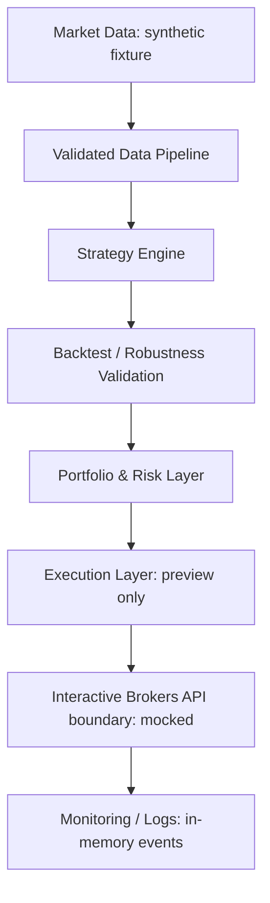

# QuantCore

A personal systematic trading infrastructure project built to research, test, and automate multi-market trading strategies.

This public edition demonstrates **AI-assisted systematic trading infrastructure** through a small, runnable Python system. All data, sizing examples and strategy rules here are artificial. It is an independently authored engineering demonstration, not a copy of a deployed trading system.

## Explore in five minutes

Requires Python 3.11 or newer. From this repository:

```sh
python -m pip install -r requirements-dev.txt
python -m pytest
python -m quantcore.demo
python scripts/check_public.py
```

Dependency installation needs a package index or pre-populated local cache. Tests and the demonstration run offline without broker software, credentials or private files. Runtime code uses only the standard library.

## Engineering demonstrated

| Area | Implementation | Evidence |
| --- | --- | --- |
| Data pipeline | Validated chronological CSV and deterministic synthetic generation | Provenance and invalid-input tests |
| Modular Strategy | Protocol separated from portfolio and execution | A deliberately simple toy trend example |
| Backtesting | Prior-close information, turnover costs and initial-capital drawdown | Lookahead and cost regression tests |
| Robustness | Expanding walk-forward selection, seeded bootstrap and parameter plateau regions | Chronological separation and reproducibility tests |
| Portfolio & risk | Inverse-volatility sizing, cash residual and Rebalance Plan | Sizing, liquidation and invalid-price tests |
| Interactive Brokers API architecture | Preview mapping to Contract/Order fields behind a mock boundary | BUY/SELL mapping and submission rejection tests |
| Monitoring | In-memory preview events with request deduplication | Idempotency and conflict tests |
| Delivery | Issues, worktrees, PR templates, ADRs and GitHub Actions | Reviewable documented workflow |

IB examples are plain-data previews: this repository contains no IB connection, session management or order submission implementation. Mock tests verify our mapping contract, not compatibility with a running IB service. A production adapter would need separate integration, reconciliation and recovery testing.

The broader research vocabulary includes cross-sectional momentum, trend following, volatility-adjusted position sizing, regime filtering, rule-based exits, sector rotation and systematic portfolio rebalancing. Only the unrelated toy trend example is implemented here; deployed strategies and their parameter combinations are excluded.

## Architecture



See [architecture](docs/architecture.md), [validation methods](docs/validation.md), [ADRs](docs/adr/README.md) and [publication review](PUBLIC_READINESS_AUDIT.md).

## AI-Assisted Development Workflow

Claude Code and Codex support implementation, refactoring, debugging, tests, documentation and research tooling within a controlled workflow:

**Issue → Branch / Worktree → AI-assisted implementation → Automated Tests → Pull Request → CI → Human Review → Merge**

AI assists implementation and iteration. Trading logic, validation standards, architecture decisions, risk management and final review remain human-controlled. See [AI workflow](docs/ai_workflow.md) and [AGENTS.md](AGENTS.md). Templates document the intended process; this fresh public repository does not claim to contain historical public issues or PRs.

## Scope and limitations

This compact example is designed for code review and interviews. It does not model exchange calendars, corporate actions, point-in-time constituents, order-book liquidity, partial fills, margin, tax, borrow fees or production fault recovery. Backtest weights are idealized fractional exposures; order planning separately illustrates integer sizing. Walk-forward outputs are independent cash-start folds, not a seamless live simulation. Bootstrap paths assume independent observations and do not establish future performance. No real-money performance figures are published.

## Disclaimer

This repository is a personal research and engineering project. It is not investment advice. It is not affiliated with, sponsored by, or endorsed by my employer. Any strategy examples are simplified or sanitized versions and are not necessarily the strategies used in live trading.
