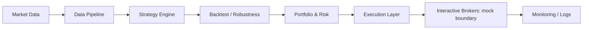

# Architecture and boundaries

`quantcore.data` owns validation and artificial inputs. `quantcore.strategy` defines the Strategy protocol. `quantcore.backtest` evaluates a target from a strict history prefix, then applies the following close-to-close return and turnover cost. `quantcore.robustness` uses that evaluator for chronological selection and resampling.

`quantcore.portfolio` independently transforms normalized weights into integer PlannedOrder records. Missing or invalid prices fail the whole plan. Holdings absent from the target are liquidated in the plan. This is illustrative sizing, not a reproduction of a deployed multi-strategy Combine operation.

`quantcore.execution` translates a PlannedOrder into IB-style Contract/Order dictionaries. MockBroker records previews and deduplicates request keys. Conflicting reuse fails. Submission always raises. No network client, endpoint, credentials, background process or scheduler is included.

Production concepts such as reconciliation, durable event storage, restart recovery, stale-data gates and broker callback handling belong behind separately reviewed interfaces. They are not implemented or claimed as tested here. Monitoring events stay in memory and contain only artificial preview keys.

Package layout is consolidated under `quantcore/` to avoid ambiguous top-level package names; module boundaries correspond to the architecture above.
